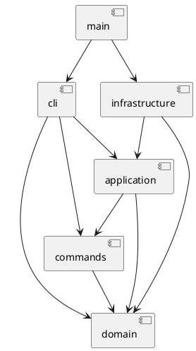

# SVG 编辑器：架构与开发记录

## 架构方案

TypeScript 严格模式，面向对象，一类一文件。命令和图形通过对象多态执行。

| 模块 | 职责 | 允许依赖 |
|---|---|---|
| domain | 六种图形、树结构、唯一 ID、几何和属性规则 | 无外层依赖 |
| commands | 编辑命令、文档快照、undo/redo | domain |
| application | 编辑会话、文档操作、输入输出端口 | domain、commands |
| infrastructure | XML 编解码、文件系统 | domain、application 的端口 |
| cli | 分词、命令分派、REPL 与输出 | application、commands、domain |
| main.ts | 组装具体依赖 | 所有层 |

### 设计模式

- Command：每类编辑命令实现统一 execute/undo/redo，History 管理两个栈。
- Composite：Shape 是统一抽象，Group 递归处理 move/scale；set 在容器上设置公共样式，遵循 SVG 样式继承。
- Memento：编辑命令保存前后文档深拷贝。先在副本上执行，成功才替换当前文档；失败不修改模型或历史。第一阶段以 O(文档大小) 的快照换取可靠恢复，未来大文档可改为增量。
- Factory：唯一图形类型分派点 ShapeFactory；唯一命令名称分派点 CommandRouter。按需求标为待重构：后续改成外部可注册 provider，目前仅内置映射。
- 端口与适配器：文件读写与 SVG 编解码隔离于领域模型，便于无 IO 测试与未来替换 UI。

### 变化点与取舍

未来可能增加图形插件、GUI/agent 输入、大文档历史优化、SVG 支持范围；分别保留 Shape 多态、编辑命令接口、History 边界、DocumentCodec 端口。本阶段不实现 box 或动态插件加载。

### 未明确语义的实现约定

- group：同父节点放在首个被选节点的位置；跨父节点放到最近共同祖先容器，按原文档深度优先顺序排列选中节点，忽略参数排列。拒绝重复参数及祖先/子孙同时入组。
- front 是 SVG 绘制最前（同级数组末尾），back 是最底（数组开头）。
- 文档操作成功后清空历史并设置 IO 屏障；失败不改变历史。canvas 查询不设屏障。新的成功编辑解除屏障。
- save 显式路径成功后成为当前保存路径；read/init 失败不更换当前文档。
- 外部 SVG 支持六种内置类型及其白名单属性；缺省几何使用 SVG 默认值。未知元素/不支持的属性明确拒绝，避免静默丢失。支持组上的 translate 和正数等比 scale，读入时归一化到子孙坐标；不承诺支持任意 SVG/CSS/path/旋转。
- 顶层 g 按题目要求禁止 ungroup；help 在没有文档时也可用。
- 宽高、半径、stroke-width 非负，画布尺寸及缩放因子正数，所有数字必须有限。

## 过程记录

1. 2026-10-29：检查远程为空、本地已有未提交骨架；需求副本与原始文件 SHA-256 相同，沿用骨架。
2. 先记录依赖方向和含糊语义；选择快照事务保证命令原子性，而非在每个命令中手工拼凑回滚。
3. 本机 Git 默认 Schannel 失败，本次网络命令使用 OpenSSL 后端；npm 缓存改到工作目录，避免修改全局配置。
4. 开发按架构骨架、领域模型、命令历史、SVG/CLI 分为四次提交。后续测试修复、示例、依赖检查、运行说明和验收记录继续独立提交；没有事后拆分或改写已有历史。
5. 测试发现内部根节点的字符串 ID 会与合法用户 ID `__canvas__` 冲突，导致树循环校验误报。将底层插入的循环判断改为对象身份检查，并增加回归测试。
6. 测试发现 XML 解析器会为缺省命名空间补充 SVG 命名空间；显式检查根节点 xmlns，保证支持范围不会被解析器默认行为扩大。
7. 本机 Node 20.0.0 与最初安装的 TypeScript 7/tsx 测试加载方式存在兼容问题。固定 TypeScript 5.7.3，移除 tsx，统一先编译再使用 Node 执行 CLI/测试；干净 npm ci 后验证成功。
8. 用户要求更细粒度提交后，示例、自动化架构检查、运行说明、最终验收记录分别提交。用户配置的远程凭据在正常账户环境可用，已成功推送早期阶段提交。提交作者明确标记为 Codex；未假定用户姓名或邮箱。
9. 用户要求继续推进后，逐条复核第 4、5 节：以多态方法修正 tree 的矩形 w/h、文字坐标、连线端点格式，并将 show 的几何和样式分行；单独提交并加入输出断言。
10. 对照错误表发现 ungroup/addto 的不存在目标错误不一致，修正为通用 no such shape；create 的 in 子句保留专用 no such container。回归测试验证错误不修改文档及历史。
11. 新增失败测试复现外部 SVG 的 __proto__ 属性被普通 JavaScript 对象吞掉的问题；将导入属性字典改为无原型对象后测试通过。未增加图形类型分派或更改白名单。
12. 将第 6 节完整会话及第 6.1 节流程图脚本作为自动化验收场景，检查预期错误、撤销结果、最终 SVG 和元素数量。新增显示、错误、导入校验、会话测试分别提交。
13. 首次交付提交 9b4a3f1 保留为 phase1-initial 标签；final 更新到本次复核后的交付提交。已发布 final 的更新使用原标签对象的显式 lease，避免覆盖他人并发更新；原有提交历史不改写。

## 一致性自查

1. **模块划分**：实际 src/domain、commands、application、infrastructure、cli 与方案一致；src/main.ts 为组装入口。FileAccess、DocumentCodec 是接口文件，其余业务类一类一文件。没有额外插件框架或 box 实现。
2. **依赖方向**：tests/architecture.test.ts 扫描全部模块的静态 import，检查允许依赖；同时验证导出类数量及文件名。当前通过。该检查是静态 import 检查，不能证明未来动态 import 或运行时依赖不存在。
3. **分派点**：CommandRouter.handlers 处理命令名，ShapeFactory.providers 处理图形类型。图形几何、容器递归和历史执行通过实例方法实现，无 switch(tag)。两处内置映射仍是后续插件注册的待重构项。
4. **修订**：初始 tsx 开发启动方式调整为先编译运行，不改变模块边界；原因见过程记录第 7 条。

## 质量保证手段

2026-10-29 在 Windows、Node.js 20.0.0 下完成：

| 检查 | 结果与范围 |
|---|---|
| npm ci | 锁文件干净安装成功；此次 npm audit 报告 0 漏洞 |
| npm run check | TypeScript strict 类型检查通过 |
| npm run build | 编译成功，输出 dist/src/main.js |
| npm test | 25/25 测试通过：23 个功能/集成/验收测试，2 个架构测试 |
| examples/session.txt | 完整会话回放成功；仅产生需求预期的祖先入组错误和 IO 撤销错误；自动补 rect1 警告正确；导入 7 个元素 |
| examples/flowchart.txt | npm run cli 管道回放成功；输出包含 8 个元素的 examples/flowchart.svg |
| 浏览器视觉检查 | 未完成：浏览器工具策略禁止 file: URL；未尝试绕过。SVG 已做 XML 解析和往返验证，但不将其等同视觉验证 |

功能测试涵盖全部六种图形、create in、move/scale/set、分组/解组/addto、前后层级、删除子树、undo/redo、redo 分支失效、IO 屏障、失败不改文档/历史/保存路径、非法数字、深层运算溢出回滚、自动 ID 避让后续显式 ID、XML 转义及中文文本、未知/畸形输入拒绝、嵌套变换、文件替换、真实 CLI 子进程。

### 验收边界

- tree 按第 5 节使用矩形 w/h、文字坐标和连线箭头格式；show 使用完整属性名并分行显示几何与样式。编辑与 undo/redo 回显结果摘要，未逐字复刻示例的自然语言措辞。
- 支持范围是本阶段 SVG 子集，不支持任意外部 SVG 的 CSS、路径、字体属性和旋转；错误明确输出，不能静默丢弃。
- 快照历史无数量上限，大文档或长会话可能占用较多内存；第一阶段未加入性能指标或持久化历史。
- 未提供作业截止时间，无法验证 final 标签是否早于课程截止时间。标签记录实际提交时刻，不回填时间。

### 需求到实现与验证的对应

| 需求章节 | 实现位置 | 验证证据 |
|---|---|---|
| 1 提交内容 | Git 分阶段历史、本文档与 PlantUML 图 | 细粒度提交、依赖检查和验收记录 |
| 2 通用约定 | cli/Tokenizer、Repl、CommandRouter；domain/Document | 引号/注释/错误/唯一 ID/无文档测试 |
| 2.1 面向对象 | domain/Shape 及六种子类、commands/EditCommand | 一类一文件与依赖检查；无 switch(tag) |
| 3 文档命令 | application/Editor、infrastructure/SvgCodec 与 LocalFiles | 成功/失败 IO、保存路径、文件替换、历史屏障 |
| 3 编辑命令 | commands 下各命令、domain/Document | 嵌套变换、分组、层级移动、删除与恢复 |
| 4.1 create/set | domain/ShapeFactory、Shape、Text | 六类型、in、默认样式、白名单及未知类型 |
| 4.2 错误 | CommandRouter 统一前缀、领域/IO 错误 | errors.test.ts、svg-validation.test.ts 及 editor.test.ts |
| 4.3 undo/redo | commands/History、EditCommand 的快照事务 | 原子回滚、redo 分支、单命令撤销与 IO 屏障 |
| 4.4 box | 明确不在本阶段实现 | create box 返回 unknown shape type |
| 5 tree/show | application/Presenter、各 Shape 的多态摘要 | display.test.ts 精确输出断言 |
| 6、6.1 会话 | examples/session.txt、flowchart.txt | replay.test.ts 两个自动化验收场景 |
