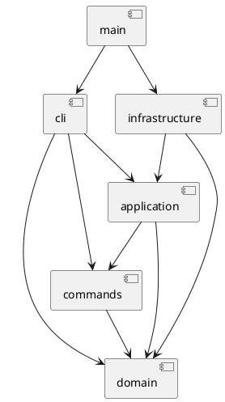

# SVG 编辑器：架构与开发记录

## 架构方案

TypeScript 严格模式，面向对象，一类一文件。命令和图形通过对象多态执行。

| 模块 | 职责 | 允许依赖 |
|---|---|---|
| domain | 六种图形、树结构、唯一 ID、几何和属性规则 | 无外层依赖 |
| commands | 编辑命令、文档快照、undo/redo | domain |
| application | 编辑会话、文档操作、输入输出端口 | domain、commands |
| infrastructure | XML 编解码、文件系统 | domain、application 的端口 |
| cli | 分词、命令分派、REPL 与输出 | application、commands、domain |
| main.ts | 组装具体依赖 | 所有层 |

### 设计模式

- Command：每类编辑命令实现统一 execute/undo/redo，History 管理两个栈。
- Composite：Shape 是统一抽象，Group 递归处理 move/scale；set 在容器上设置公共样式，遵循 SVG 样式继承。
- Memento：编辑命令保存前后文档深拷贝。先在副本上执行，成功才替换当前文档；失败不修改模型或历史。第一阶段以 O(文档大小) 的快照换取可靠恢复，未来大文档可改为增量。
- Factory：唯一图形类型分派点 ShapeFactory；唯一命令名称分派点 CommandRouter。按需求标为待重构：后续改成外部可注册 provider，目前仅内置映射。
- 端口与适配器：文件读写与 SVG 编解码隔离于领域模型，便于无 IO 测试与未来替换 UI。

### 变化点与取舍

未来可能增加图形插件、GUI/agent 输入、大文档历史优化、SVG 支持范围；分别保留 Shape 多态、编辑命令接口、History 边界、DocumentCodec 端口。本阶段不实现 box 或动态插件加载。

### 未明确语义的实现约定

- group：同父节点放在首个被选节点的位置；跨父节点放到最近共同祖先容器，按原文档深度优先顺序排列选中节点，忽略参数排列。拒绝重复参数及祖先/子孙同时入组。
- front 是 SVG 绘制最前（同级数组末尾），back 是最底（数组开头）。
- 文档操作成功后清空历史并设置 IO 屏障；失败不改变历史。canvas 查询不设屏障。新的成功编辑解除屏障。
- save 显式路径成功后成为当前保存路径；read/init 失败不更换当前文档。
- 外部 SVG 支持六种内置类型及其白名单属性；缺省几何使用 SVG 默认值。未知元素/不支持的属性明确拒绝，避免静默丢失。支持组上的 translate 和正数等比 scale，读入时归一化到子孙坐标；不承诺支持任意 SVG/CSS/path/旋转。
- 顶层 g 按题目要求禁止 ungroup；help 在没有文档时也可用。
- 宽高、半径、stroke-width 非负，画布尺寸及缩放因子正数，所有数字必须有限。

## 过程记录

1. 2026-10-29：检查远程为空、本地已有未提交骨架；需求副本与原始文件 SHA-256 相同，沿用骨架。
2. 先记录依赖方向和含糊语义；选择快照事务保证命令原子性，而非在每个命令中手工拼凑回滚。
3. 本机 Git 默认 Schannel 失败，本次网络命令使用 OpenSSL 后端；npm 缓存改到工作目录，避免修改全局配置。

## 一致性自查

实现后填写实际检查结果，不预先宣称通过。

## 质量保证手段

计划：类型检查、构建、领域与历史单元测试、XML 往返测试、CLI 脚本回放、生成 SVG 浏览器预览。测试特别覆盖失败原子性、嵌套结构、自动 ID 与 IO 屏障。
